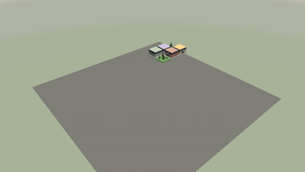

# tinywfc

[](https://github.com/varnholt/tinywfc/actions/workflows/ci.yml)

Wave function collapse in a single C++23 header: the simple tiled model on 2D and 3D grids, with backtracking,
parallel restarts and rules built from per-face sockets. No dependencies beyond the standard library.



**[Watch it build a city in your browser](https://varnholt.github.io/tinywfc/)**: the testbed compiled to WebAssembly
and WebGL 2. Streets, canals and parks are decided first, then buildings grow storey by storey out of the adjacency
rules, and an elevated road on pillars crosses the streets below.

```cpp
#include <tinywfc/tinywfc.h>

// three tiles: land, coast, sea; sea never touches land
tinywfc::Rules rules{3};
rules.allowEverywhere(0, 0);  // land next to land, on every side
rules.allowEverywhere(0, 1);  // land next to coast
rules.allowEverywhere(1, 1);
rules.allowEverywhere(1, 2);  // coast next to sea
rules.allowEverywhere(2, 2);
rules.setWeight(2, 2.0f);     // more sea

auto solver = tinywfc::Solver::create(rules, {._size = {64, 1, 64}, ._seed = 42});
if (solver && solver->run())
{
   const std::vector<tinywfc::TileId> tiles = solver->result();  // one tile per cell
}
```

## Rules in 3D

A grid has an x, y and z size; y is up, and a 2D grid simply has a size of 1 on one axis. Every cell has six neighbors
(`Direction::PositiveX` ... `NegativeZ`). There are two ways to say which tile may sit next to which:

- **explicit pairs:** `rules.allow(a, Direction::PositiveY, b)` lets `b` sit on top of `a` (and `a` below `b`).
  `allowEverywhere(a, b)` allows a pair on all six sides.
- **sockets per face:** describe each tile by a socket on each of its six faces, up and down included. Two tiles fit
  where the touching sockets are equal. `rulesFromSockets` builds the rules, and `rotateY` turns a tile's sockets by
  quarter turns around y, so one design gives up to four rotated tiles:

```cpp
enum class Socket { Ground, Lot, Road, Sky, House };
using enum Socket;
// +x, -x, +y (top), -y (bottom), +z, -z
const std::array street{Lot, Lot, Sky, Ground, Road, Road};
std::vector<tinywfc::SocketTile<Socket>> tiles{
   {street, 2.0f},                                // a street along z
   {tinywfc::rotateY(street, 1), 2.0f},           // ... turned to run along x
   {{Lot, Lot, House, Ground, Lot, Lot}, 3.0f},   // a ground floor
   {{Lot, Lot, House, House, Lot, Lot}, 1.0f},    // a floor: house below and above
   {{Lot, Lot, Sky, House, Lot, Lot}, 1.0f},      // a roof
   {{Lot, Lot, Sky, Sky, Lot, Lot}, 1.0f},        // air
};
auto rules = tinywfc::rulesFromSockets<Socket>(tiles);
```

The vertical sockets do the stacking: a floor needs a house below and something with a house socket on top, a roof
ends the building, and nothing floats because air only sits on sky. The testbed's city (`testbed/city.cpp`) is built
this way. It also uses oriented vertical sockets (a deck along z only fits on pillars meant for it), `restrict()` and
`ban()` to keep ground tiles on the ground and open floors away from the top layer, and `setPriority()` to decide the
city layer by layer, so a building's height comes from the stacking rules.

## API

| | |
|---|---|
| `Rules{count}`, `allow`, `allowEverywhere`, `setWeight` | tiles, adjacency, relative frequency |
| `SocketTile`, `rulesFromSockets`, `rotateY` | rules from per-face sockets |
| `Solver::create(rules, settings)` | `std::expected<Solver, Error>` |
| `restrict(cell, tiles)`, `ban(cell, tile)` | constraints before (or while) solving |
| `setPriority(cell, value)` | observation order: lowest priority + entropy first, e.g. layer by layer |
| `step()`, `run()`, `restart()` | one observation, everything, the next attempt |
| `tile(cell)`, `possibilityCount(cell)`, `collapsedCount()`, `result()` | the state |
| `setCollapseCallback`, `setResetCallback` | watch cells collapse, and backtracks or restarts undo them |
| `Settings` | `_size`, `_seed`, `_periodic`, `_max_backtracks`, `_max_restarts`, `_threads` |

Errors (`Error::Contradiction`, `InvalidSize`, ...) come back as `std::expected`; nothing throws. Results are
reproducible: the same rules, settings and seed give the same grid with any thread count. The random numbers come from
xoshiro256**, not from the standard distributions, which differ between standard libraries.

**Threads:** a `Solver` is a value and not thread safe; use one from one thread at a time. `Rules` are only read and may
be shared by any number of threads. `run()` with `Settings::_threads > 1` (0 = one per hardware thread) tries the first
attempt on the calling thread; only if that fails do the next attempts run in parallel on a pool of `std::jthread`s. The
lowest numbered attempt that succeeds wins and the higher ones are cancelled through `std::stop_token`, so the result is
the same as with one thread. Those attempts work on private copies and call no callbacks. In a browser without threads,
`_threads` is ignored and everything runs on the calling thread through the same API.

## How it works, and how fast

Each step observes the open cell with the lowest Shannon entropy (from cached sums of `w` and `w log w`, through a lazy
min heap) and picks one of its tiles by weight. Propagation is AC-4: every cell keeps, per side, a count of compatible
tiles left in the neighbor. Tiles with the same compatibility list on a side share one counter, which turns socket based
rule sets with many tiles per socket into a handful of counters. A tile leaves a cell as soon as one count reaches
zero, without rescanning the neighbor. Every removal goes onto a trail that a contradiction undoes. Contradictions in a
row backjump 1, 2, 4, ... decisions, so a cause far back is reached quickly, and the earliest undone choice is banned.
When backtracking gives up, the next attempt starts over with a derived seed.

`tinywfc_bench` (built with the tests) solves each scenario with 7 seeds. Median times on a Core Ultra 9 285HX with
MSVC; "before" is the original version of this repository on the same 2D rules, which gave up at the first
contradiction and had no 3D:

| scenario | before | tinywfc, 1 thread | tinywfc, 24 threads | solved |
|---|---|---|---|---|
| roads 32^2 (20 tiles) | 42.9 ms, solved 5/5 | 1.3 ms | 1.5 ms | 7/7 |
| roads 128^2 | 358 ms, solved 2/5 | 164 ms | 165 ms | 7/7 |
| three colors 32^2 | gave up 5/5 | 0.8 ms | 0.9 ms | 7/7 |
| three colors 128^2 | gave up 5/5 | fails after 2.0 s | fails after 0.35 s | 0/7 |
| pipes 32^3 (64 tiles) | no 3D | 179 ms | 173 ms | 7/7 |
| three colors 32^3 | no 3D | 7.1 s | 1.0 s | 3/7 |

So 30x faster on the small roads grid, every roads grid solved instead of 2 of 5, and up to 7x faster with threads
where restarts are needed. Grids that succeed in their first attempt run on one thread either way.

The large three color grids are the hard case: their contradictions come from long cycles of constraints far away from
the decision that caused them. Backjumping solves the small ones; the big ones need many attempts, which is where the
parallel restarts help most.

## Testbed

`testbed/` is a Dear ImGui viewer on OpenGL ES 3.0 (SDL3; WebGL 2 in the browser) that builds a 3D city: streets,
canals, bridges and parks; buildings stacked from a ground floor with a door, floors and three roof shapes; an elevated
road on pillars with ramps. All meshes are procedural (`testbed/meshes.cpp`), there are no asset files. Natively the
city is solved on a worker thread and played back at an adjustable pace; in the browser a bounded number of steps runs
per frame. The testbed is built by default only when tinywfc is the top level project, and it is never installed.

```
cmake -S . -B build
cmake --build build --config Release
build/testbed/Release/tinywfc_testbed
```

```
tinywfc_testbed [--seed N] [--grid XxYxZ] [--size WxH] [--speed CELLS_PER_SECOND]
                [--screenshot out.png [--ui]]
                [--record DIR [--frames N] [--fps F] [--orbit RADIANS_PER_SECOND]]
```

`--screenshot` and `--record` render offscreen and quit. The GIF above is

```
tinywfc_testbed --seed 3 --grid 14x6x14 --record frames --frames 150 --fps 25 --size 960x540 --orbit 0.2
ffmpeg -framerate 25 -i frames/frame_%04d.png -vf "fps=12.5,scale=600:-1:flags=lanczos,split[a][b];[a]palettegen=max_colors=64:stats_mode=diff[p];[b][p]paletteuse=dither=bayer:bayer_scale=5:diff_mode=rectangle" doc/city.gif
```

Natively the testbed asks the driver for an OpenGL ES 3.0 context; where there is none it falls back to OpenGL 4.3
core, which runs the same `#version 300 es` shaders.

## Use it

Copy `include/tinywfc/tinywfc.h`, or with CMake:

```cmake
include(FetchContent)
FetchContent_Declare(tinywfc GIT_REPOSITORY https://github.com/varnholt/tinywfc.git GIT_TAG main)
FetchContent_MakeAvailable(tinywfc)
target_link_libraries(your_target PRIVATE tinywfc::tinywfc)
```

or install it (`cmake --install build --prefix <prefix>`) and use `find_package(tinywfc)`. The package is the header
and its CMake files; a consumer pulls in nothing else. Options: `TINYWFC_BUILD_TESTS` and `TINYWFC_BUILD_TESTBED` (both
on for the top level project only), `TINYWFC_INSTALL`.

Requirements: CMake 3.25 and a C++23 compiler; CI builds with MSVC, GCC 14, Clang 20 and AppleClang. With an old glibc,
`std::jthread` may need `-pthread`.

## Not (yet) in here

- the overlapping model, which learns the rules from a sample image
- terrain slopes and stairs in the city

## Rust

[`rust/`](rust/README.md) contains the native `tinywfc` Rust crate: no dependencies and no C++ toolchain required. It includes examples, tests against the C++ implementation, and Cargo packaging. See the [Rust README](rust/README.md) for the API and local installation.

## License

MIT, see [LICENSE](LICENSE).
